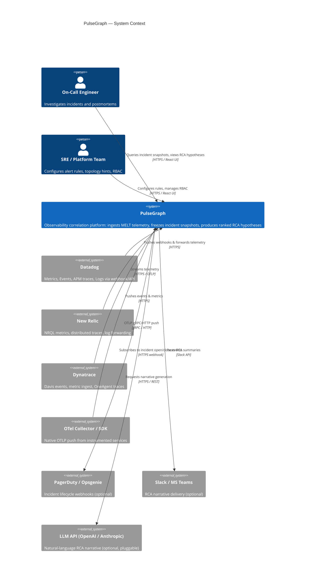
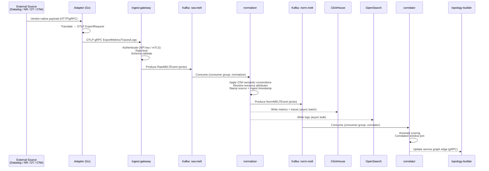

# PulseGraph — High-Level Design

> **Status:** Draft v0.1 · Jul 2026  
> **Owner:** Platform Architecture

---

## Table of Contents

1. [Context & Drivers](#1-context--drivers)
2. [C4 Context Diagram](#2-c4-context-diagram)
3. [C4 Container Diagram](#3-c4-container-diagram)
4. [End-to-End Data Flows](#4-end-to-end-data-flows)
5. [Incident Snapshot Design](#5-incident-snapshot-design)
6. [RCA Engine Design](#6-rca-engine-design)
7. [API Surface](#7-api-surface)
8. [Failure Modes & Resilience](#8-failure-modes--resilience)
9. [Security](#9-security)
10. [Deployment Topology](#10-deployment-topology)
11. [Phased Delivery](#11-phased-delivery)

---

## 1. Context & Drivers

### Problem Statement

Modern production systems emit MELT telemetry (Metrics, Events, Logs, Traces) across multiple vendors — Datadog, New Relic, Dynatrace, and native OpenTelemetry collectors. During an incident, on-call engineers must manually correlate signals across these siloed tools to identify root cause. Mean Time to Diagnose (MTTD) is dominated by this cross-tool correlation work, often consuming 60–80 % of total incident time.

PulseGraph is an **observability correlation platform** that:
- Ingests MELT signals from heterogeneous sources in real time.
- Normalises all signals to the OpenTelemetry (OTel) data model as the single canonical representation.
- Continuously correlates signals, builds a dynamic service topology graph, and detects anomalies.
- Freezes an immutable **incident snapshot** the moment an incident is triggered, capturing the exact state of every related entity across the relevant time window.
- Runs a multi-strategy **Root Cause Analysis (RCA)** engine that produces ranked hypotheses with evidence chains.
- Exposes a query API and React console so engineers can navigate the evidence without switching tools.

### Architectural Drivers

| Driver | Requirement |
|--------|-------------|
| **Vendor agnosticism** | Must ingest from Datadog, New Relic, Dynatrace, and native OTel without coupling internal models to any vendor schema. |
| **Low-latency ingest** | P99 ingest-to-correlation latency ≤ 5 s for steady-state MELT volume. |
| **Immutable snapshots** | Incident evidence must be frozen and tamper-proof for audit and postmortem. |
| **Pluggable RCA** | Rules, graph analysis, statistical anomaly detection, and LLM-assisted narrative are independently deployable strategies. |
| **Operational simplicity** | Single `docker compose up` for local development; cloud-native Kubernetes path for production. |
| **Incremental delivery** | MVP in 8 weeks; v1 with full RCA in 16 weeks; v2 with LLM narrative and multi-tenancy in 6 months. |

---

## 2. C4 Context Diagram



---

## 3. C4 Container Diagram

```mermaid
C4Container
    title PulseGraph — Container View

    Person(oncall, "On-Call Engineer")

    System_Boundary(pulsegraph, "PulseGraph") {

        %% ── Adapters ──────────────────────────────────────────────────────────
        Container(adapter_dd,    "adapter-datadog",    "Go",        "Receives Datadog webhooks & API poll; translates to OTLP")
        Container(adapter_nr,    "adapter-newrelic",   "Go",        "Receives New Relic streaming telemetry; translates to OTLP")
        Container(adapter_dt,    "adapter-dynatrace",  "Go",        "Receives Dynatrace problem events & metrics; translates to OTLP")
        Container(adapter_otel,  "adapter-otel",       "Go",        "Native OTLP receiver (gRPC + HTTP); validates & forwards")

        %% ── Ingest layer ──────────────────────────────────────────────────────
        Container(ingest,        "ingest-gateway",     "Go",        "Auth, rate-limit, schema validation, fan-out to Kafka")

        %% ── Stream processing ─────────────────────────────────────────────────
        Container(kafka,         "Kafka / Redpanda",   "Infra",     "Durable event bus; topics: raw.melt, norm.melt, corr.events, snapshot.commands, rca.results")
        Container(normalizer,    "normalizer",         "Go",        "Consumes raw.melt; applies OTel schema; enriches resource attributes; publishes norm.melt")
        Container(correlator,    "correlator",         "Go",        "Consumes norm.melt; detects anomalies; emits corr.events; triggers snapshot commands")
        Container(topology,      "topology-builder",   "Go",        "Maintains live service-dependency graph; exposes gRPC topology API")

        %% ── Snapshot & RCA ────────────────────────────────────────────────────
        Container(snapshotter,   "snapshotter",        "Go",        "Consumes snapshot.commands; queries stores; writes immutable bundle to object store")
        Container(rca,           "rca-engine",         "Python",    "Consumes snapshot refs; runs rule/graph/ML/LLM strategies; publishes rca.results")

        %% ── Query & UI ────────────────────────────────────────────────────────
        Container(api_gw,        "api-gateway",        "Go",        "JWT authn, RBAC authz, rate-limit; routes to query-api and topology-builder")
        Container(query_api,     "query-api",          "Go",        "REST + gRPC; serves incidents, snapshots, RCA hypotheses, topology queries")
        Container(console,       "console",            "TypeScript / React", "Single-page app; incident timeline, topology graph, RCA hypothesis explorer")

        %% ── Storage ───────────────────────────────────────────────────────────
        ContainerDb(clickhouse,  "ClickHouse",         "Column store", "Metrics + traces (norm.melt ingested via ClickHouse Kafka consumer)")
        ContainerDb(opensearch,  "OpenSearch",         "Search engine","Logs (full-text + structured search)")
        ContainerDb(minio,       "MinIO / S3",         "Object store", "Immutable incident snapshot bundles (Parquet + JSON manifests)")
        ContainerDb(postgres,    "PostgreSQL",         "RDBMS",       "Incidents, RCA records, alert rules, topology hints, RBAC, audit log")
    }

    System_Ext(datadog,   "Datadog")
    System_Ext(newrelic,  "New Relic")
    System_Ext(dynatrace, "Dynatrace")
    System_Ext(otel_col,  "OTel Collector")
    System_Ext(llm,       "LLM API")

    Rel(datadog,   adapter_dd,   "Webhook / API poll", "HTTPS")
    Rel(newrelic,  adapter_nr,   "Streaming telemetry", "HTTPS")
    Rel(dynatrace, adapter_dt,   "Problem events", "HTTPS")
    Rel(otel_col,  adapter_otel, "OTLP gRPC / HTTP", "gRPC")

    Rel(adapter_dd,   ingest, "OTLP spans/metrics/logs", "gRPC")
    Rel(adapter_nr,   ingest, "OTLP spans/metrics/logs", "gRPC")
    Rel(adapter_dt,   ingest, "OTLP spans/metrics/logs", "gRPC")
    Rel(adapter_otel, ingest, "OTLP validated", "gRPC")

    Rel(ingest,      kafka,      "Publish raw.melt",         "Kafka producer")
    Rel(kafka,       normalizer, "Consume raw.melt",         "Kafka consumer")
    Rel(normalizer,  kafka,      "Publish norm.melt",        "Kafka producer")
    Rel(kafka,       correlator, "Consume norm.melt",        "Kafka consumer")
    Rel(correlator,  kafka,      "Publish corr.events / snapshot.commands", "Kafka producer")
    Rel(correlator,  topology,   "Update topology graph",    "gRPC")
    Rel(kafka,       snapshotter,"Consume snapshot.commands","Kafka consumer")
    Rel(snapshotter, minio,      "Write snapshot bundle",    "S3 API")
    Rel(snapshotter, postgres,   "Write incident record",    "SQL")
    Rel(kafka,       rca,        "Consume snapshot refs",    "Kafka consumer")
    Rel(rca,         minio,      "Read snapshot bundle",     "S3 API")
    Rel(rca,         topology,   "Query dependency graph",   "gRPC")
    Rel(rca,         llm,        "Narrative generation (optional)", "HTTPS")
    Rel(rca,         kafka,      "Publish rca.results",      "Kafka producer")
    Rel(kafka,       query_api,  "Consume rca.results → Postgres", "Kafka consumer")

    Rel(normalizer,  clickhouse, "Write metrics + traces",   "ClickHouse Kafka consumer / HTTP")
    Rel(normalizer,  opensearch, "Write logs",               "OpenSearch bulk API")

    Rel(oncall,      console,    "HTTPS",                    "Browser")
    Rel(console,     api_gw,     "REST / WebSocket",         "HTTPS")
    Rel(api_gw,      query_api,  "gRPC / REST proxy",        "gRPC")
    Rel(query_api,   clickhouse, "Metrics/trace queries",    "ClickHouse HTTP")
    Rel(query_api,   opensearch, "Log search",               "OpenSearch REST")
    Rel(query_api,   minio,      "Fetch snapshot bundles",   "S3 API")
    Rel(query_api,   postgres,   "Incidents, RCA, RBAC",     "SQL")
    Rel(query_api,   topology,   "Live topology",            "gRPC")
```



---

## 4. End-to-End Data Flows

### 4.1 Steady-State MELT Ingest



### 4.2 Incident Trigger → Freeze/Snapshot Pipeline

```mermaid
sequenceDiagram
    participant C   as correlator
    participant K3  as Kafka: snapshot.commands
    participant S   as snapshotter
    participant CH  as ClickHouse
    participant OS  as OpenSearch
    participant TB  as topology-builder
    participant M   as MinIO/S3
    participant PG  as PostgreSQL
    participant K4  as Kafka: snapshot.refs

    C->>C: Anomaly score exceeds threshold<br/>or external alert webhook received
    C->>PG: INSERT incident (id, started_at, severity, trigger_labels)
    C->>K3: Produce SnapshotCommand<br/>{incident_id, window_start, window_end, entity_ids}

    K3->>S: Consume SnapshotCommand
    S->>CH: Query metrics + traces for entity_ids × [window_start–window_end + 2 min buffer]
    S->>OS: Query logs for entity_ids × window
    S->>TB: GetSubgraph(entity_ids, depth=2)
    S->>S: Assemble SnapshotBundle<br/>(Parquet partitions + JSON manifest)
    S->>M: PUT s3://pulsegraph-snapshots/{incident_id}/ (immutable, versioned)
    S->>PG: UPDATE incident SET snapshot_uri, snapshot_sha256, snapshot_frozen_at
    S->>K4: Produce SnapshotRef {incident_id, s3_uri, sha256}

    Note over M: Object lock / WORM policy;<br/>SHA-256 manifest ensures integrity
```

### 4.3 RCA Analysis → Ranked Hypotheses → UI

```mermaid
sequenceDiagram
    participant K4  as Kafka: snapshot.refs
    participant R   as rca-engine (Python)
    participant M   as MinIO/S3
    participant TB  as topology-builder
    participant LLM as LLM API (optional)
    participant K5  as Kafka: rca.results
    participant QA  as query-api
    participant PG  as PostgreSQL
    participant UI  as console (React)

    K4->>R: Consume SnapshotRef
    R->>M: GET snapshot bundle (Parquet + manifest)
    R->>TB: GetSubgraph for incident entities

    par Strategy: Rules
        R->>R: Evaluate deterministic rule set<br/>(e.g. "error-rate spike → dependency failure")
    and Strategy: Graph Walk
        R->>R: PageRank / causal graph walk<br/>on topology + anomaly scores
    and Strategy: Anomaly ML
        R->>R: Isolation Forest / z-score on<br/>metric time-series in snapshot
    end

    R->>R: Merge & rank hypotheses<br/>Assign confidence scores + evidence refs

    opt LLM narrative enabled
        R->>LLM: Prompt with hypothesis JSON + evidence excerpts
        LLM->>R: Natural-language incident narrative
    end

    R->>K5: Produce RCAResult {incident_id, hypotheses[], narrative?}
    K5->>QA: Consume → upsert postgres rca_results
    QA->>PG: INSERT rca_hypotheses (rank, confidence, evidence_refs, narrative)

    UI->>QA: GET /v1/incidents/{id}/rca
    QA->>UI: RCAResponse (hypotheses, topology snapshot, evidence links)
    UI->>UI: Render hypothesis explorer,<br/>evidence diff, topology graph overlay
```



---

## 5. Incident Snapshot Design

### 5.1 Capture Window

| Parameter | Value | Rationale |
|-----------|-------|-----------|
| **Pre-incident window** | T−10 min | Captures metric drift and anomalous traces before trigger |
| **Post-trigger buffer** | T+2 min | Captures immediate propagation effects |
| **Total default window** | 12 min (configurable per rule) | Balances completeness vs snapshot size |
| **Entity scope** | Direct entities + depth-2 topology neighbours | Captures upstream/downstream blast radius |

### 5.2 Storage Layout

```
s3://pulsegraph-snapshots/
└── {incident_id}/                          ← UUID v7 (time-ordered)
    ├── manifest.json                       ← SHA-256, schema version, entity list, window bounds
    ├── metadata.json                       ← incident severity, trigger source, alert labels
    ├── topology/
    │   └── subgraph.json                   ← nodes + edges (OTel resource attributes + spans)
    ├── metrics/
    │   └── metrics.parquet                 ← partitioned by service × metric name
    ├── traces/
    │   └── traces.parquet                  ← root spans + sampled children, flattened
    ├── logs/
    │   └── logs.parquet                    ← structured logs, severity-filtered
    └── rca/
        └── {rca_run_id}.json               ← hypothesis array + evidence refs (appended per run)
```

### 5.3 Immutability Guarantees

- **Object-lock WORM** (MinIO / S3 Object Lock): snapshots are written with `COMPLIANCE` retention — no deletion before retention expiry (default 90 days).
- **SHA-256 manifest**: `manifest.json` lists SHA-256 of every file in the bundle. The manifest hash itself is recorded in PostgreSQL `incidents.snapshot_sha256`.
- **Append-only RCA**: RCA results are appended under `rca/` with their own run IDs; no file is ever overwritten.
- **Audit log**: Every snapshot access is recorded in PostgreSQL `snapshot_access_log` (actor, timestamp, operation).

---

## 6. RCA Engine Design

### 6.1 Strategy Pipeline

```
SnapshotBundle
      │
      ▼
┌─────────────────────────────────────┐
│  Strategy Orchestrator (Python)     │
│  ┌──────────────┐ ┌───────────────┐ │
│  │ Rule Engine  │ │ Graph Analyst │ │
│  │  (YAML rules)│ │ (NetworkX)    │ │
│  └──────────────┘ └───────────────┘ │
│  ┌──────────────┐ ┌───────────────┐ │
│  │ Anomaly ML   │ │ LLM Narrator  │ │
│  │ (scikit-learn│ │ (OpenAI/Anth.)│ │
│  │  / statsmodels)│ │ [optional]  │ │
│  └──────────────┘ └───────────────┘ │
│              │                      │
│     Merge + Rank (Borda count +     │
│     weighted confidence fusion)     │
└──────────────────────────┬──────────┘
                           │
                    RCAResult proto
```

### 6.2 Strategy Details

**Rule Engine**  
- YAML-defined rules with predicates over OTel attributes (e.g. `service.error.rate > 0.05 AND upstream.latency_p99 > 1s`).  
- Each rule fires zero or more hypotheses with a fixed base-confidence.  
- Rules are versioned in Git and hot-reloaded without service restart.

**Graph Analyst**  
- Loads the topology subgraph from the snapshot.  
- Runs **causal graph walk**: starts from anomalous nodes (score > threshold), propagates blame upstream following call edges (depth-first, decaying weight).  
- Produces a ranked list of candidate root-cause services.

**Anomaly ML**  
- For each metric series in the snapshot, computes a z-score against the 7-day baseline stored in ClickHouse.  
- Isolation Forest for multivariate anomaly across metric-by-service matrix.  
- Outputs per-entity anomaly scores that feed into confidence computation.

**LLM Narrator (pluggable)**  
- Invoked only if `rca.llm.enabled=true` in config.  
- Receives a structured prompt: top-3 hypotheses + evidence excerpts (≤ 4 k tokens).  
- Returns natural-language incident narrative.  
- Failure is non-blocking: RCA result is published with `narrative: null`.

### 6.3 Hypothesis Schema

```json
{
  "rank": 1,
  "confidence": 0.87,
  "hypothesis": "Downstream service payments-svc experienced connection pool exhaustion, causing cascading timeout errors in checkout-svc.",
  "strategies_contributed": ["rule_engine", "graph_analyst"],
  "evidence": [
    {
      "type": "metric",
      "entity": "payments-svc",
      "metric": "db.connection_pool.exhausted",
      "value": 1.0,
      "timestamp": "2026-07-11T13:55:00Z",
      "snapshot_ref": "metrics/metrics.parquet#row_group=3"
    },
    {
      "type": "log",
      "entity": "checkout-svc",
      "excerpt": "context deadline exceeded: payments-svc:8080",
      "severity": "ERROR",
      "timestamp": "2026-07-11T13:55:02Z",
      "snapshot_ref": "logs/logs.parquet#row_group=1"
    }
  ],
  "narrative": "At 13:55 UTC, PulseGraph detected..."
}
```

---

## 7. API Surface

> Full OpenAPI spec lives at `docs/api/openapi.yaml` (generated). The table below covers key endpoints only.

### 7.1 REST API (`/v1/`)

| Method | Path | Description |
|--------|------|-------------|
| `POST` | `/v1/ingest/otlp/v1/metrics` | OTLP/HTTP metrics ingestion (adapter-otel) |
| `POST` | `/v1/ingest/otlp/v1/traces` | OTLP/HTTP traces ingestion |
| `POST` | `/v1/ingest/otlp/v1/logs` | OTLP/HTTP logs ingestion |
| `POST` | `/v1/webhooks/datadog` | Datadog alert/event webhook receiver |
| `POST` | `/v1/webhooks/dynatrace` | Dynatrace problem event receiver |
| `GET`  | `/v1/incidents` | List incidents (paginated, filterable by severity/time) |
| `GET`  | `/v1/incidents/{id}` | Get incident detail + snapshot URI |
| `GET`  | `/v1/incidents/{id}/snapshot` | Stream or presign snapshot bundle |
| `GET`  | `/v1/incidents/{id}/rca` | Get ranked RCA hypotheses |
| `POST` | `/v1/incidents/{id}/rca/rerun` | Trigger fresh RCA run |
| `GET`  | `/v1/topology/graph` | Current live topology graph |
| `GET`  | `/v1/topology/graph/{service}` | Subgraph centred on service |
| `GET`  | `/v1/metrics/query` | ClickHouse-backed instant metric query |
| `GET`  | `/v1/metrics/query_range` | Range metric query (Prometheus-compatible) |
| `GET`  | `/v1/logs/search` | OpenSearch log search |
| `GET`  | `/v1/traces/{trace_id}` | Fetch distributed trace |
| `GET`  | `/v1/health` | Liveness probe |
| `GET`  | `/v1/ready` | Readiness probe |

### 7.2 gRPC Services (internal)

| Service | Package | Key RPCs |
|---------|---------|----------|
| `IngestService` | `pulsegraph.ingest.v1` | `ExportMetrics`, `ExportTraces`, `ExportLogs` |
| `TopologyService` | `pulsegraph.topology.v1` | `GetGraph`, `GetSubgraph`, `UpdateEdge` |
| `SnapshotService` | `pulsegraph.snapshot.v1` | `GetSnapshotMeta`, `ListSnapshots` |
| `RCAService` | `pulsegraph.rca.v1` | `GetHypotheses`, `TriggerRerun` |

### 7.3 WebSocket

- `WS /v1/incidents/stream` — server-sent incident open/update/close events for the console real-time feed.
- `WS /v1/rca/{incident_id}/stream` — progressive RCA result streaming as strategies complete.

---

## 8. Failure Modes & Resilience

### 8.1 Backpressure

- All adapters publish to `ingest-gateway` via gRPC with streaming backpressure; slow consumers cause adapters to apply exponential back-off.
- `ingest-gateway` enforces per-tenant rate limits (token bucket, configurable via PostgreSQL). Excess traffic returns HTTP 429 / gRPC `RESOURCE_EXHAUSTED`.
- Kafka topic `raw.melt` is sized with `retention.bytes` per partition to absorb 2× peak burst. Consumers apply `max.poll.records` caps to avoid processing overload.

### 8.2 Dead-Letter Queues

| Topic | DLQ Topic | Retry Policy |
|-------|-----------|--------------|
| `raw.melt` | `raw.melt.dlq` | Normalizer retries 3× with 1 s back-off; poison messages are routed to DLQ + alerting |
| `norm.melt` | `norm.melt.dlq` | Correlator retries 3× |
| `snapshot.commands` | `snapshot.commands.dlq` | Snapshotter retries 5× with jitter; DLQ triggers PagerDuty alert |
| `rca.refs` | `rca.refs.dlq` | RCA engine retries 2×; DLQ emits a partial-result incident update |

### 8.3 Vendor Adapter Outage

Each adapter operates independently. A Datadog adapter restart or outage does not affect New Relic, Dynatrace, or OTel pipelines. Adapters that use API polling (Datadog metrics backfill) track a `last_fetched_cursor` in PostgreSQL and replay from the cursor on restart to avoid data loss.

### 8.4 ClickHouse / OpenSearch Degradation

- `normalizer` uses an async write path with a local disk-backed queue (BadgerDB). If ClickHouse is unreachable for > 30 s, writes are buffered locally (up to 1 GB) and replayed on reconnection.
- Query-api falls back to degraded-mode responses (metadata-only) when storage is unavailable, rather than returning 500s.

### 8.5 Snapshot Write Failure

If MinIO is unreachable, `snapshotter` holds the SnapshotCommand in-memory and retries for up to 5 min. After that, it publishes a `snapshot.failed` event and marks the incident `snapshot_status=degraded` in PostgreSQL. RCA will run without a bundle, using only live topology data.

### 8.6 RCA Engine Failure

rca-engine is a Python worker pool. A crash loop does not affect ingest or the console. The incident is surfaced to the UI as `rca_status=pending`. On rca-engine restart it reprocesses unacknowledged `rca.refs` messages from Kafka (consumer group offset is only committed on successful publish of `rca.results`).

---

## 9. Security

### 9.1 Authentication

- **Console / REST API**: JWT (RS256) issued by the api-gateway after OIDC/OAuth2 login. Tokens expire in 1 hour; refresh tokens are short-lived.
- **Service-to-service (internal)**: mTLS with certificates provisioned by an internal CA (cert-manager in k8s; local CA in docker-compose dev mode).
- **Adapter webhooks**: Per-source shared HMAC secrets validated at `ingest-gateway` before processing. Secrets rotated via Vault / environment variables.

### 9.2 Authorisation (RBAC)

| Role | Capabilities |
|------|-------------|
| `viewer` | Read incidents, snapshots, RCA results for assigned tenants |
| `operator` | Viewer + trigger RCA rerun, acknowledge incidents |
| `admin` | Operator + manage alert rules, RBAC, topology hints |
| `system` | Internal service identity (mTLS only); not assignable to humans |

RBAC policies are stored in PostgreSQL (`roles`, `role_bindings`, `tenants` tables) and cached in api-gateway (TTL 60 s).

### 9.3 Data Isolation (Multi-tenancy)

- All telemetry records carry a `tenant_id` resource attribute.
- ClickHouse and OpenSearch queries are always tenant-scoped; api-gateway injects the claim.
- Snapshot bundles are stored under `s3://pulsegraph-snapshots/{tenant_id}/{incident_id}/` and access-controlled by IAM/MinIO policies.
- PostgreSQL row-level security (RLS) enforces tenant isolation on `incidents`, `rca_results`, and `snapshot_access_log`.

### 9.4 Secrets Management

- Kubernetes: secrets via HashiCorp Vault + vault-agent sidecar or External Secrets Operator.
- docker-compose local: secrets passed via `.env` file (gitignored); a `scripts/generate-dev-secrets.sh` creates per-developer values.
- LLM API keys are stored as encrypted secrets; the RCA engine never logs them.

### 9.5 Data in Transit / At Rest

- All external traffic: TLS 1.3+.
- Snapshot bundles: encrypted at rest with SSE-S3 (AES-256).
- ClickHouse and PostgreSQL: encrypted volumes in production; plaintext acceptable in local dev.

---

## 10. Deployment Topology

### 10.1 Local Development (`docker-compose`)

```
┌────────────────────────────────────────────────────────────┐
│  docker-compose.yml                                         │
│                                                             │
│  ┌──────────────┐  ┌──────────────┐  ┌──────────────────┐  │
│  │ adapter-dd   │  │ adapter-nr   │  │  adapter-otel    │  │
│  └──────┬───────┘  └──────┬───────┘  └────────┬─────────┘  │
│         └─────────────────┴───────────────────┘            │
│                           │ gRPC                            │
│                  ┌────────▼─────────┐                      │
│                  │  ingest-gateway  │                      │
│                  └────────┬─────────┘                      │
│                           │ Kafka                           │
│         ┌─────────────────▼─────────────────────┐          │
│         │           Redpanda (single node)       │          │
│         └───┬─────────┬──────────────────────────┘         │
│             │         │                                     │
│      ┌──────▼──┐ ┌────▼─────┐ ┌────────────┐               │
│      │normaliz-│ │correlator│ │topology-   │               │
│      │  er     │ └────┬─────┘ │  builder   │               │
│      └──┬──────┘      │       └─────┬──────┘               │
│         │             │             │                       │
│  ┌──────▼──┐    ┌─────▼──────┐      │                       │
│  │Click-   │    │snapshotter │      │                       │
│  │House    │    └─────┬──────┘      │                       │
│  └─────────┘          │             │                       │
│  ┌──────────┐   ┌─────▼──────┐      │                       │
│  │OpenSearch│   │  MinIO     │      │                       │
│  └──────────┘   └────────────┘      │                       │
│  ┌──────────┐   ┌────────────┐      │                       │
│  │PostgreSQL│   │ rca-engine │──────┘                       │
│  └──────────┘   └─────┬──────┘                              │
│                       │                                     │
│              ┌────────▼─────────┐                           │
│              │  api-gateway /   │                           │
│              │   query-api      │                           │
│              └────────┬─────────┘                           │
│                       │ HTTPS:3000                          │
│              ┌────────▼─────────┐                           │
│              │    console       │                           │
│              └──────────────────┘                           │
└────────────────────────────────────────────────────────────┘
```

Compose profiles:
- `--profile minimal` — ingest-gateway + Redpanda + normalizer + ClickHouse + Postgres (no RCA, no UI)
- `--profile full` (default) — all services
- `--profile test` — deterministic data generators + all services

### 10.2 Future Kubernetes Topology

```
Kubernetes Cluster
├── namespace: pulsegraph-ingest
│   ├── Deployment: adapter-datadog   (HPA: CPU)
│   ├── Deployment: adapter-newrelic  (HPA: CPU)
│   ├── Deployment: adapter-dynatrace (HPA: CPU)
│   ├── Deployment: adapter-otel      (HPA: CPU)
│   └── Deployment: ingest-gateway    (HPA: CPU + RPS)
│
├── namespace: pulsegraph-stream
│   ├── StatefulSet: Redpanda cluster (3 brokers)
│   ├── Deployment: normalizer        (HPA: Kafka lag)
│   ├── Deployment: correlator        (HPA: Kafka lag)
│   └── Deployment: topology-builder  (StatefulSet, consistent hash)
│
├── namespace: pulsegraph-snapshot
│   ├── Deployment: snapshotter       (HPA: Kafka lag)
│   └── Deployment: rca-engine        (HPA: Kafka lag, GPU nodes optional)
│
├── namespace: pulsegraph-api
│   ├── Deployment: api-gateway       (HPA: RPS)
│   ├── Deployment: query-api         (HPA: CPU)
│   └── Deployment: console           (static assets via CDN)
│
└── namespace: pulsegraph-storage
    ├── StatefulSet: ClickHouse       (3-shard × 2-replica)
    ├── StatefulSet: OpenSearch       (3 master + 3 data)
    ├── StatefulSet: PostgreSQL       (primary + 1 standby, via CloudNativePG)
    └── StatefulSet: MinIO            (4-node erasure-coded, or AWS S3)
```

---

## 11. Phased Delivery

### Phase 0 — Foundation (Weeks 1–2)

- Mono-repo scaffolding, docker-compose skeleton, Redpanda + ClickHouse + OpenSearch + Postgres up.
- Proto schema definitions for `RawMELTEvent`, `NormMELTEvent`, `SnapshotCommand`, `RCAResult`.
- CI pipeline: lint, unit test, proto generation.

### Phase 1 — MVP: Ingest + Normalise + Query (Weeks 3–8)

- `adapter-otel`: OTLP gRPC/HTTP receiver, forward to ingest-gateway.
- `ingest-gateway`: API key auth, schema validation, Kafka producer.
- `normalizer`: OTel semantic convention mapping, ClickHouse + OpenSearch writer.
- `topology-builder`: basic service graph from span `peer.service` attributes.
- `query-api` + `api-gateway`: REST endpoints for metrics/traces/logs/topology.
- `console`: minimal UI — service map, metric charts, log search.
- Deliverable: engineers can query normalised telemetry from OTel-instrumented services.

### Phase 2 — Incident Snapshots + Basic RCA (Weeks 9–16)

- `correlator`: anomaly scoring (z-score), alert-webhook receivers (Datadog, Dynatrace).
- `adapter-datadog`, `adapter-newrelic`, `adapter-dynatrace`: vendor translation.
- `snapshotter`: snapshot bundle assembly, MinIO writer, PostgreSQL incident record.
- `rca-engine`: rule engine + graph analyst strategies.
- `console`: incident timeline, snapshot explorer, hypothesis list.
- Deliverable: on-call engineer sees ranked RCA hypotheses within 60 s of incident trigger.

### Phase 3 — ML Anomaly + LLM Narrative + Multi-tenancy (Weeks 17–24)

- `rca-engine`: Isolation Forest ML strategy, confidence fusion.
- LLM narrator integration (pluggable, opt-in per tenant).
- Multi-tenancy: RBAC, tenant-scoped storage, audit log.
- WORM object lock enforcement in MinIO / S3.
- Performance hardening: ClickHouse sharding, Kafka partition tuning, correlator scaling.
- Deliverable: production-ready v1 with SLA-backed ingest, RCA < 90 s P95, full audit trail.

### Phase 4 — Kubernetes + Enterprise (Month 7+)

- Helm charts for all services.
- KEDA-based autoscaling on Kafka consumer lag.
- Vault integration for secrets.
- SOC 2 controls: encryption at rest, log retention policies, penetration-test remediation.
- Deliverable: v2 on-prem / cloud-hosted offering.

---

*For deeper component internals and sequence diagrams, see [ARCHITECTURE.md](./ARCHITECTURE.md).*  
*For architectural decision records, see [adr/](./adr/).*
