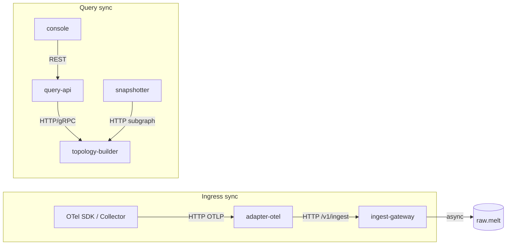

# Communication Patterns — Java Microservices Fork

---

## 1. Pattern summary

| Pattern | Where used | Protocol |
|---------|------------|----------|
| **Async event streaming** | Primary pipeline | Kafka / Redpanda (JSON envelopes) |
| **Sync HTTP ingress** | Adapters → gateway; OTLP clients → adapter-otel | HTTP/JSON |
| **Sync HTTP query** | Console → query-api; snapshotter → topology | HTTP/JSON |
| **gRPC (planned)** | query-api ↔ topology; internal high-QPS | gRPC |
| **Object store I/O** | snapshotter, rca-engine | S3 API (MinIO) |
| **DB access** | query-api, topology persistence, metadata | JDBC (Postgres, ClickHouse HTTP/native) |

**Design rule (ADR-0002):** Stream stages do **not** call each other synchronously for the happy path. Decoupling is via durable topics.

---

## 2. Kafka topic contracts

| Topic | Producers | Consumers | Payload |
|-------|-----------|-----------|---------|
| `raw.melt` | ingest-gateway | normalizer | `MeltEnvelope` |
| `raw.melt.dlq` | normalizer (on poison) | ops / replay | failed raw |
| `norm.melt` | normalizer | correlator, topology-builder, snapshotter (buffer) | normalized envelope |
| `norm.melt.dlq` | consumers | ops | failed norm |
| `corr.events` | correlator | query-api, optional triggers | correlation records |
| `snapshot.commands` | correlator, query-api, webhooks | snapshotter | `SnapshotCommand` |
| `snapshot.refs` | snapshotter | rca-engine, query-api | `SnapshotRef` |
| `rca.results` | rca-engine | query-api | ranked hypotheses |
| `topology.changes` | topology-builder | query-api, correlator | graph deltas |
| `incidents` | correlator / query-api | snapshotter, console via API | incident lifecycle |

Java services should use the **same topic names and JSON schemas** so Go and Java can dual-run during migration.

---

## 3. Synchronous edges (exceptions)

| Call | Timeout guidance | Failure behavior |
|------|------------------|------------------|
| adapter → gateway | 5–10s | Adapter returns 502; client retries |
| snapshotter → topology | 5s | Freeze **degraded** with empty/partial graph |
| console → query-api | 2s p95 target | UI shows stale/error toast |
| rca → MinIO GET | 30s | RCA degraded / retry |

---

## 4. Consumer groups (Java)

| Service | Group ID | Topic |
|---------|----------|-------|
| normalizer | `normalizer` | `raw.melt` |
| correlator | `correlator` | `norm.melt` |
| topology-builder | `topology-builder` | `norm.melt` |
| snapshotter-buffer | `snapshotter-buffer` | `norm.melt` |
| snapshotter | `snapshotter` | `snapshot.commands` |
| rca-engine | `rca-engine` | `snapshot.refs` |

Multiple consumers on `norm.melt` are intentional (fan-out).

---

## 5. Communication anti-patterns (avoid in Java rewrite)

- Normalizer calling snapshotter over HTTP to “force” freeze.
- RCA calling correlator synchronously for live joins (use freeze bundle + graph snapshot).
- Adapters writing ClickHouse directly (always via gateway → bus → normalizer).
- Console talking to Kafka (always via query-api).

---

## 6. Observability of the bus itself

Each Java service emits:
- Consumer lag (Micrometer + Kafka metrics)
- Produce/consume error rates
- DLQ depth alerts

Self-dogfood via OTLP into `adapter-otel` where possible.
