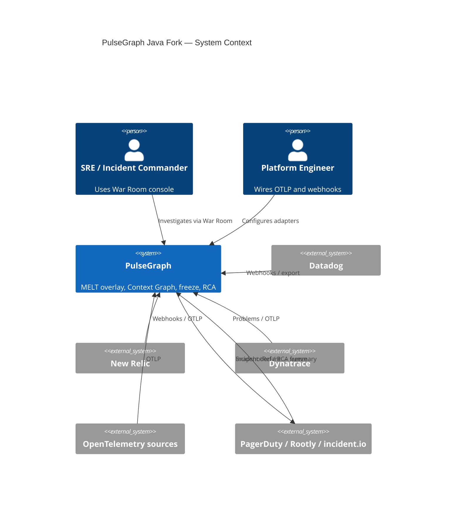
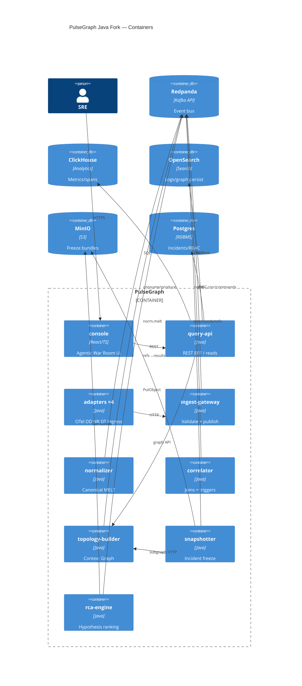
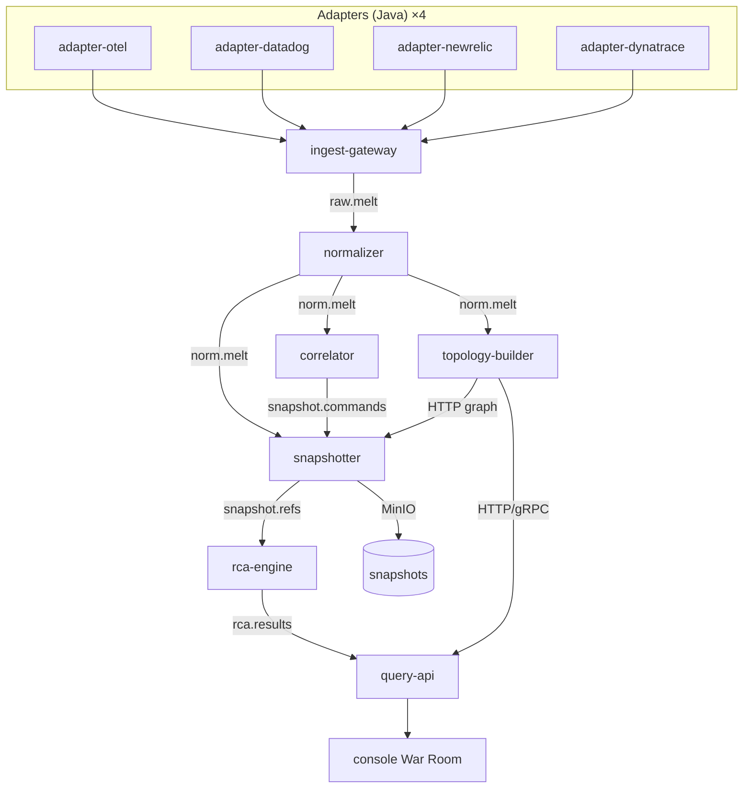

# High-Level Architecture — Java Microservices Fork

---

## 1. Architectural intent

PulseGraph remains a **platform-agnostic MELT overlay**:
- Federate Datadog / New Relic / Dynatrace / OTel
- Build a **Context Graph**
- **Freeze** incident evidence
- Run **RCA** and present an **Agentic War Room** (UI)

The Java fork preserves **event-driven microservices** (ADR-0002) with **11** Spring/Quarkus services + React console.

---

## 2. C4 Context diagram



---

## 3. C4 Container diagram



---

## 4. Logical pipeline (high level)



---

## 5. Deployment view (pilot)

```text
                    ┌─────────────────────────────────┐
                    │  Single VM (Oracle A1 / local)   │
                    │  docker compose: bus + stores    │
                    │  JVM processes ×11 (or compose)  │
                    │  Node: console :3000             │
                    └─────────────────────────────────┘
```

Kubernetes is **deferred** (same as Go pilot strategy). Prefer:
- One process per service JAR
- or one Compose file `deploy/java/docker-compose.yml` later

---

## 6. Non-functional targets (carry over)

| Metric | Target |
|--------|--------|
| Ingest→norm p95 | ≤ 30s under pilot load |
| Freeze API | seconds when MinIO/topology healthy |
| query-api p95 | ≤ 2s |
| RCA first hypothesis | ≤ 5 min (async) |

---

## 7. Migration / dual-run

1. Keep Kafka contracts identical.  
2. Run Java `normalizer` beside Go with a **new consumer group** offline, then cut group.  
3. Swap adapters last (ingress risk).  
4. Console unchanged throughout.
