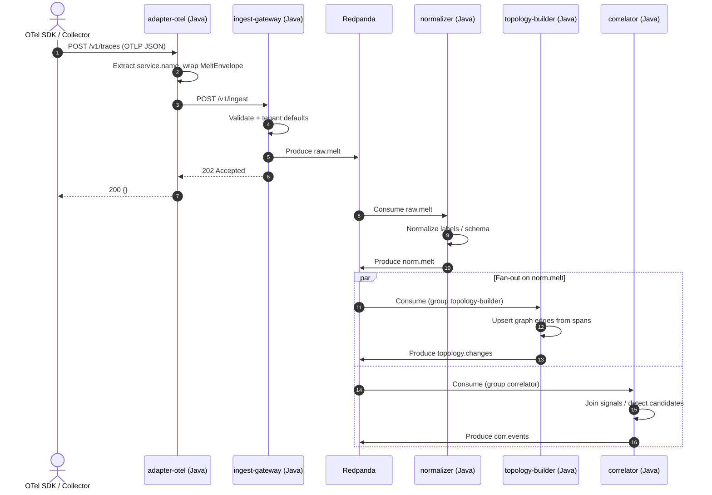
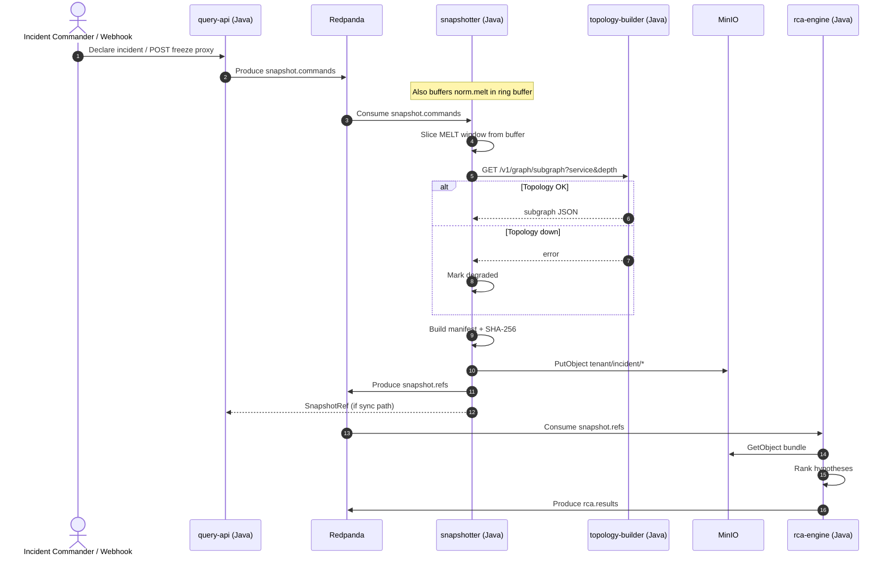
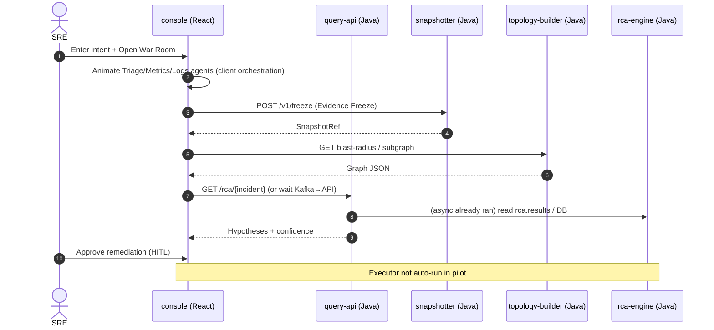
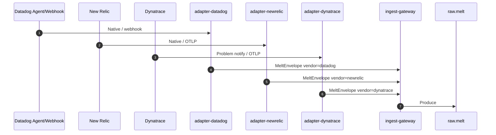
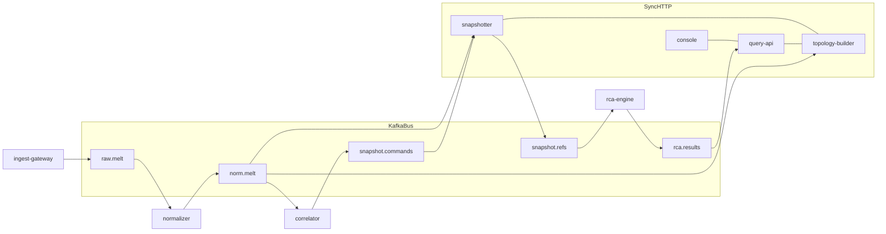

# Sequence & Interaction Diagrams — Java Fork

All diagrams assume **Java** implementations of the named services; contracts match the Go system.

---

## 1. Steady-state MELT ingest

---

## 2. Incident freeze (snapshot) pipeline

**Direct War Room path (sync):** console → Vite `/freeze` proxy → snapshotter `POST /v1/freeze` (same freeze engine; still publishes `snapshot.refs`).

---

## 3. Agentic War Room interaction (UI + backend)

---

## 4. Multi-vendor adapter interaction

---

## 5. Component interaction map (static)

---

## 6. Failure & degradation interactions

| Failure | Interaction behavior |
|---------|----------------------|
| Kafka unavailable | Gateway returns 503; adapters surface 502 |
| Topology down during freeze | Snapshotter writes bundle with `degraded_reasons+=topology_unavailable` |
| Empty MELT buffer | `empty_melt_window`; still writes manifest |
| RCA slow | UI shows freeze + graph first; hypotheses arrive async |
| MinIO full | Freeze fails hard; alert ops |

---

## 7. Traceability to War Room investigation steps

| War Room step | PulseGraph interaction |
|---------------|------------------------|
| Triage | Intent + severity in UI / correlator |
| Parallel investigate | Agents over freeze + live APIs |
| RCA | `rca-engine` ← `snapshot.refs` |
| Blast radius | `topology-builder` subgraph API |
| Remediate HITL | Console approve (no silent exec) |
| **+ Evidence Freeze** | `snapshotter` (PulseGraph differentiator) |
